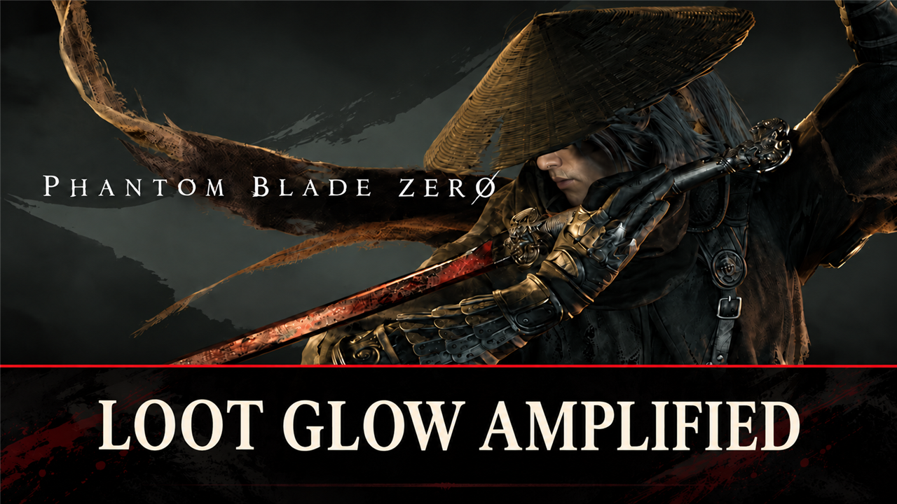

# Loot Glow Amplified

Brighter and larger glow over loot piles and chests. Brightness and size are set in config.lua, live in game.

## What it does

Loot is easier to spot: the glow over loot piles and chests is brighter and larger.

- Brighter: the beam and the sparkles over the loot shine twice as bright, and the light they cast on the ground is
  stronger and reaches further.
- Larger: the glow is twice as tall and wide.
- For loot piles (also notes, pages and other pickups) and chests; each group can be turned off.
- Settings change live: edit `config.lua`, save, and the game shows the change within a few seconds.

What stays as in the game:

- Which glows show: the game's own distance limit (about 45 m, the nearest few glows).
- Taken piles and opened chests stay dark.
- The effects that other things share (for example the glow of some characters) do not change.

It is a UE4SS Lua script: it changes the glow effects in memory while the game runs. It replaces no game file and
does not touch your save.

## Screenshots

## How to install

1. Install UE4SS for Phantom Blade Zero, for example [UE4SS](https://github.com/KintaroModding/ue4ss) (its zip
   `phantombladezero_ue4ss_<version>.zip`: the official UE4SS build with a config that makes it run in this game).
2. Download the zip of the latest release on GitHub (`phantombladezero_lootglowamplified_<version>.zip`).
3. Unpack it into the game folder `platform\steam\`, next to the game's exe. It adds the folder
   `ue4ss\Mods\phantombladezero_lootglowamplified\` (with the file `enabled.txt`, UE4SS starts it by itself).
4. Start the game.

To check that it runs: `platform\steam\ue4ss\UE4SS.log` has the line `[Loot Glow Amplified] <version> loaded.`

To update the mod, replace the folder with the one of the new release; to keep your settings, put your old
`Scripts\config.lua` back (a setting that it does not have keeps its default). To remove it, delete the folder
`ue4ss\Mods\phantombladezero_lootglowamplified\`.

## How to use

Nothing to do: the mod works as soon as you load a game. A glow that comes into view takes up to 2 seconds to change.

## Settings

The settings are in `platform\steam\ue4ss\Mods\phantombladezero_lootglowamplified\Scripts\config.lua`. Open it with a
text editor, change a value and save: the mod reads the file every 5 seconds, so you see the change in the game
without a restart. A file it cannot read (for example a typo) keeps the last settings. `UE4SS.log` shows the settings
in use in the line `[Loot Glow Amplified] Settings: ...`, and names each value it could not use.

| Setting | Default | What it does |
|---|---|---|
| `Enable` | `true` | `false` puts every glow back as the game has it, without removing the mod |
| `Brightness` | `2` | How bright the beam, the sparkles and the light around the loot are: 1 = as in the game, up to 5 |
| `Size` | `2` | How big the glow is: 1 = as in the game, 2 = twice as tall and wide, up to 5 |
| `Chests` | `true` | `false`: chests keep the game's glow |
| `Items` | `true` | `false`: loot piles (also notes, pages and other pickups) keep the game's glow |
| `LogDetail` | `false` | `true`: `UE4SS.log` lists every change and a status line (for tests) |

## Compatibility

- Game version: Release (Steam build 26266538) (`CL-301524_JKS-17219`).
- Tested with UE4SS `v3.0.1-1188-gf885e8d2`.
- Mods that change the loot glow effects themselves (as files) may add to this mod or be hidden by it.

## Known issues

- UE4SS's hot reload (Ctrl+R) while the glows are boosted: restart the game afterwards, or the lights can get
  brighter with each reload.

## How to build

There is nothing to build: `src\phantombladezero_lootglowamplified\Scripts\main.lua` is the mod. `tests\test_main.py` runs the script
outside the game with Lua 5.4 ([lupa](https://pypi.org/project/lupa/)) and mocks of UE4SS:
`python tests\test_main.py`. `README.md` has the details.

## Credits

Made by Kintaro. MIT license: you may use, change and share this mod. UE4SS is made by the
[UE4SS-RE team](https://github.com/UE4SS-RE/RE-UE4SS). Phantom Blade Zero belongs to its makers.
